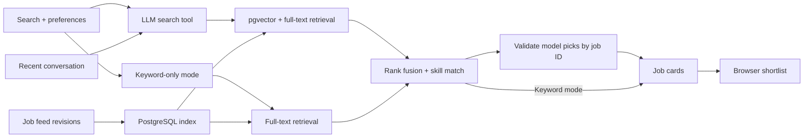

# Job Compass

**Search by what you want to build, follow up in plain English, and keep a shortlist.**

Job Compass is a job discovery app built with FastAPI, PostgreSQL, pgvector, and an LLM that calls a typed search tool. Results come from an index that can be updated while the app is running.

## Try this search

1. Add **Python, PostgreSQL, FastAPI** to your skills and turn on **Remote only**.
2. Ask **“Find remote roles building data pipelines.”**
3. Follow up with **“Which of those involve AI?”** The agent can use the previous results to understand what “those” means.
4. Save an interesting result and find it later under **Saved jobs**. The shortlist stays in this browser.

Choose **Search keywords** for a direct database search with the same preference filters and no model call. This mode does not add a conversational turn.

## How a match is made



- **Retrieval.** HNSW finds semantically similar jobs and PostgreSQL full-text search finds keyword matches. Reciprocal rank fusion combines the candidate lists and matched skills adjust the order. Remote and salary filters apply before ranking.
- **Memory.** PostgreSQL stores the profile and the six most recent exchanges per session. Versioned writes prevent concurrent requests from silently overwriting each other.
- **Grounding.** The service checks that every model-selected ID was retrieved. If the model returns invalid picks twice, it displays the highest-ranked listings. Titles, companies, URLs, and salaries come from the index.
- **Freshness.** Feed batches use stable IDs and increasing revisions. Older events are ignored. An inactive revision removes the job from search and prevents stale events from restoring it.

## Run locally

Copy `.env.example` to `.env`. Set a random `APP_TOKEN` of at least 24 characters and an `OPENAI_API_KEY`, then run:

```powershell
docker compose up --build
```

In a second terminal, set `$env:APP_TOKEN` to the same value from `.env`, then import the fictional listings:

```powershell
curl.exe -X POST http://localhost:8000/jobs -H "Authorization: Bearer $env:APP_TOKEN" -H "Content-Type: application/json" --data-binary "@fixtures/jobs.json"
```

Open `http://localhost:8000` and enter the application token. The API reference is at `/docs`.

## Evaluate changes

```powershell
python -m unittest discover -s tests -v
python -m evals.ranking
```

The tests check personalization and rejection of unsupported recommendations. The ranking replay compares semantic-only candidate ordering with personalized hybrid ranking using fixed relevance judgments and **MRR@3** (mean reciprocal rank at three). GitHub Actions runs both checks. For a larger evaluation, capture real candidate lists and label them before tuning ranking weights.

## Operate the service

`POST /jobs` accepts up to 50 records per batch. To close a listing, send the record with a higher revision and `active: false`. Salary is annual USD. Setting a salary floor excludes listings whose pay is undisclosed.

The Docker setup targets a trusted single-operator instance. It includes a readiness endpoint, bounded connection pooling, request timeouts, and a non-root API container. For public hosting, add per-user authentication and session authorization, separate credentials for ingestion, TLS, rate limits, and database backups. Use a migration process for schema changes to an existing database.

[pgvector filtered searches](https://github.com/pgvector/pgvector#filtering) · [OpenAI Chat Completions](https://developers.openai.com/api/reference/resources/chat/subresources/completions/methods/create)
